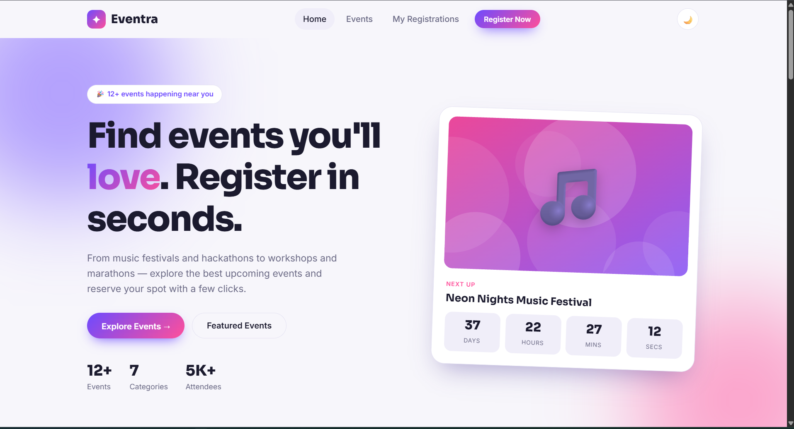
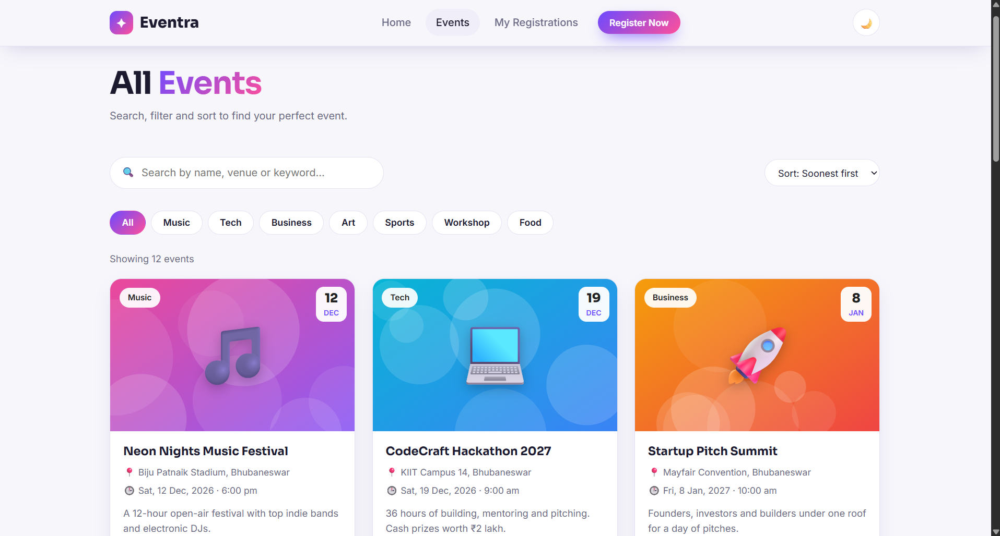
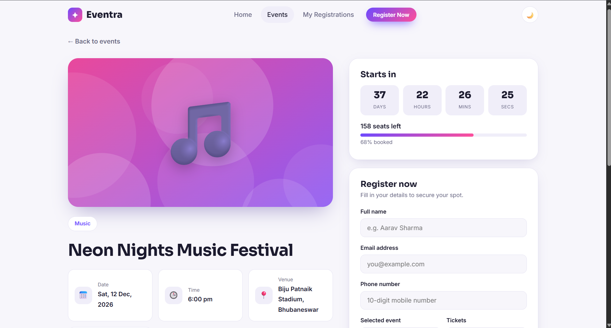
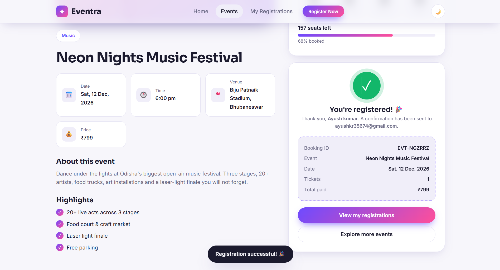
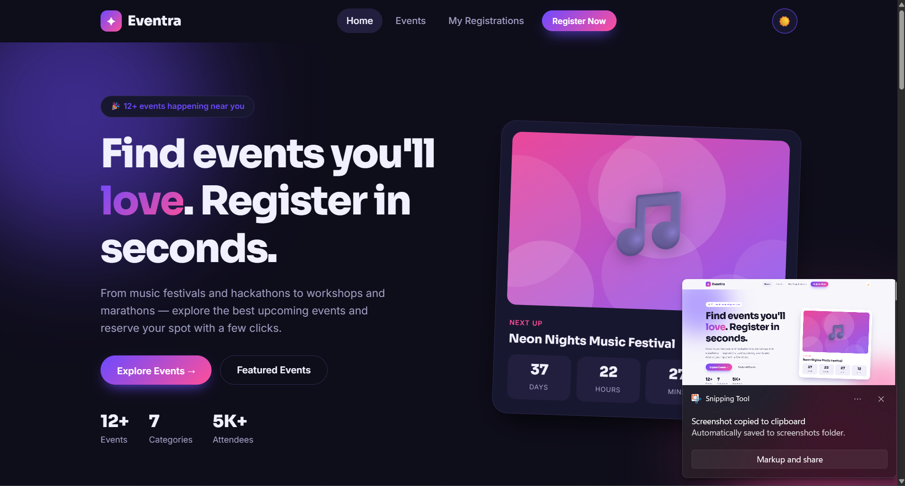

# Eventra — Event Management Website

## 👤 Author

- **Name:** Ayush Kumar
- **Roll No.:** 24051700
- **Email:** 24051700@kiit.ac.in
- **College:** KIIT (Kalinga Institute of Industrial Technology)


A modern, fully responsive event management website where users can explore upcoming events, search and filter them, view details and register with validated forms.
Built with **HTML5, CSS3 and vanilla JavaScript** (no frameworks, no build tools).

**Live demo:** _add your deployed link here_  
**Repository:** https://github.com/24051700-ayush/Eventra.git

## Features
- Hero section with live countdown to the next event
- Featured and upcoming event cards (name, date, venue, image, short description, price, seats left)
- Search, category filters and sorting
- Event detail page with highlights, countdown timer and seat availability bar
- Registration form (name, email, phone, selected event, tickets) with JavaScript validation
- Success confirmation with a booking ID
- **Bonus:** dark/light mode, countdown timers, scroll animations, Local Storage registration management (view/cancel bookings, duplicate-email check, live seat count)
- Responsive for mobile, tablet and desktop; accessible (labels, focus styles, reduced-motion support)

## Project structure
```
index.html           Home (hero, featured, categories, upcoming, how it works)
events.html          All events with search / filter / sort
event.html           Event details + registration form (event.html?id=1)
registrations.html   User's bookings from Local Storage
css/style.css        All styles, theme variables, responsive rules
js/data.js           Event data, SVG cover generator, storage + format helpers
js/main.js           Shared header/footer, theme toggle, countdown, animations
js/home.js · events.js · event.js · registrations.js   Page logic
```

## Validation rules
| Field | Rule |
|---|---|
| Name | Required, 3+ chars, letters/spaces only |
| Email | Required, valid email format; one booking per email per event |
| Phone | Required, valid 10-digit Indian mobile (6–9 start; +91/0 prefix allowed) |
| Event | Must be selected |
| Tickets | 1–10 and not more than seats left |
| Terms | Must be accepted |

## 📸 Screenshots

### Home Page


### All Events (Search, Filter & Sort)


### Event Details & Registration Form


### Registration Confirmation


### Dark Mode


## Run locally
Open `index.html` in a browser, or run `python -m http.server 8000` and visit http://localhost:8000.

## Deploy
Push to GitHub, then enable **GitHub Pages** (Settings → Pages → Deploy from branch → `main` / root), or import the repo in Netlify / Vercel (no build command, output directory `.`).

## Tech
HTML5 · CSS3 (Grid, Flexbox, custom properties) · JavaScript (ES6+) · Local Storage
